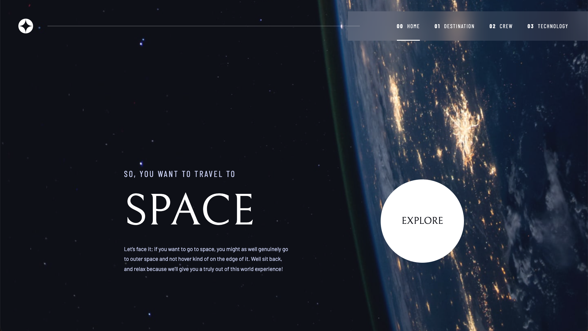

# Frontend Mentor - Space tourism website solution

This is a solution to the [Space tourism website challenge on Frontend Mentor](https://www.frontendmentor.io/challenges/space-tourism-multipage-website-gRWj1URZ3).

## Table of contents

- [Overview](#overview)
    - [The challenge](#the-challenge)
    - [Screenshot](#screenshot)
    - [Links](#links)
- [My process](#my-process)
    - [Built with](#built-with)
    - [What I learned](#what-i-learned)
    - [Continued development](#continued-development)
    - [AI collaboration](#ai-collaboration)
    - [Useful resources](#useful-resources)
    - [Running locally](#running-locally)
- [Author](#author)

## Overview

### The challenge

Users should be able to:

- View layouts adapted to desktop, tablet, and mobile screens.
- See hover states on interactive elements.
- Navigate between the Home, Destination, Crew, and Technology pages.
- Switch between destinations, crew members, and technologies to view their details.

### Screenshot



### Links

- Solution URL: [https://github.com/Jair-MV/Space-Tourism](https://github.com/Jair-MV/Space-Tourism)
- Live Site URL: [https://space-tourism-jmv-dev-mx.netlify.app](https://space-tourism-jmv-dev-mx.netlify.app)

## My process

### Built with

- Semantic HTML5
- SCSS and CSS custom properties
- Flexbox and CSS Grid
- Vanilla JavaScript
- JSON data loaded with `fetch`

### What I learned

The most important lesson was how to organize styles with a clear SCSS architecture. Separating abstracts, base styles, components, layout, and page styles makes the project easier to maintain and gives it room to grow.

One detail I'm particularly proud of is the thin white line that extends from the navigation across the header. Its width follows the viewport automatically, so I didn't need separate breakpoints to adjust its length at different desktop sizes:

```scss
.main-nav::before {
    content: "";
    position: absolute;
    top: 50%;
    left: 5%;
    width: calc(100vw - 900px);
    height: 1px;
    background-color: hsl(var(--clr-neutral-max) / 0.5);
    transform: translateY(-50%) rotate(180deg);
    transform-origin: left;
}
```

The `calc()` expression makes the line grow or shrink with the viewport. The existing breakpoint at 1300px hides it when the layout no longer has enough space.

### Continued development

I want to keep improving my responsive design skills, especially how layouts adapt across screen sizes. I also want to learn more about accessibility and how to implement it in practice, and explore other approaches to organizing styles.

### AI collaboration

I built the initial page layouts by hand. I then used AI to help implement the JavaScript functionality and refine some UI details. I asked it to explain the code instead of only providing a solution, so I could understand the changes. This project also gave me a chance to experiment with working alongside AI agents.

### Useful resources

- [Sass Guidelines: The 7-1 Pattern](https://sass-guidelin.es/#the-7-1-pattern) - A reference for organizing SCSS files and keeping styles maintainable.

### Running locally

Install dependencies and start a local HTTP server from the project root:

```bash
npm install
python3 -m http.server 8000
```

Open `http://localhost:8000` in your browser. A local server is needed because the Destination, Crew, and Technology pages fetch their content from `data.json`.

To recompile the SCSS files while editing, run `npm run dev` in another terminal. Use `npm run build` to generate compressed CSS.

## Author

- GitHub - [Jair-MV](https://github.com/Jair-MV)
